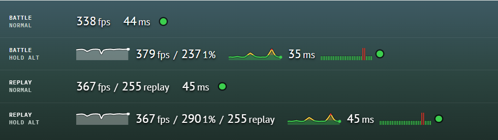

# FPS, Ping and Lag by Sagtary

A World of Tanks mod that shows FPS, ping and lag in battle and in replays, in place of the game's own FPS/ping panel.



## What it shows

One line in the top left corner. Hold **Alt** (the game's extended info key) to see more: the graphs, 1% low and the
lag history. In replays the line also shows the FPS recorded in the replay.

### FPS

#### Current FPS

Frames per second now. Example: `338fps`.

- Counted over the last second, from the time of every frame.
- In a replay: the FPS of the playback now.

#### FPS graph

FPS history for the last 30 seconds, newest on the right. Alt only.

- One point per second, white.
- The scale goes from 0 to the highest point, so a drop stands out.

#### 1% low

FPS of the slowest moments. Alt only. Example: `237 1%`.

- The FPS of the slowest 1% of the time over the last 30 seconds.
- Shows stutters that the average FPS hides: 379 fps with 237 1% means short drops to about 237.

#### Replay FPS

FPS of the recorded battle. Replays only. Example: `255replay`.

- The FPS the game's own panel showed when the battle was played and recorded.

### Ping

#### Current ping

Ping to the server in milliseconds. Example: `44ms`.

- The same value as the game's own panel showed.
- In a replay: the ping recorded in it.
- During lag it freezes at the last value.

#### Ping graph

Ping history for the last 30 seconds, newest on the right. Alt only.

- One point per second, coloured by value with the game's own scale for server ping in the hangar:
  - green: up to 59 ms (good);
  - yellow: 60–119 ms (normal);
  - red: 120 ms and more (high).
- A spike to 131 ms shows green at the bottom, yellow in the middle and red at the top.
- The dot at the end has the colour of the current ping.

### Lag

#### Lag lamp

Connection to the server now.

- Green: updates from the server arrive.
- Red: updates stopped, so the ping and the positions of other tanks are out of date. It turns red within 0.4 s.
- This is the game's own lag signal, the lamp of its panel. High ping alone does not make it red.
- In a replay: the lag recorded in it.

#### Lag ticks

Lag history for the last 30 seconds, newest on the right. Alt only.

- One tick per second.
- Short and green: no lag in that second.
- Tall and red: there was lag at least once in that second.

## Install

Copy `sagtary.fps_ping_<version>.wotmod` into the game's `mods\<game version>\` folder.

## Build

Build with Python 2.7, the game's Python version:

```text
C:\Python27\python.exe build.py            # build/<id>_<version>.wotmod
C:\Python27\python.exe build.py --install  # also copy it into the game's mods folder
```

The game folder is `D:\programs\World_of_Tanks_EU` unless the `WOT_DIR` environment variable says otherwise.
