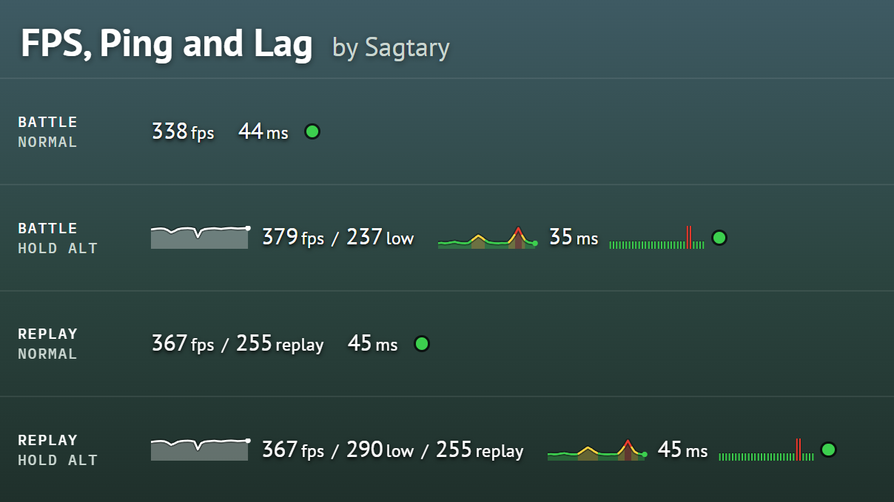

# FPS, Ping and Lag

Short description: Exact FPS, 1% low, ping and lag in one line, with 30-second graphs on Alt. Works in replays.

## Mod description

Replaces the game's FPS/ping panel in the top left corner with one line: FPS, ping and a lag lamp.

Hold **Alt** (the game's extended info key) to see more: graphs of the last 30 seconds for FPS and ping, 1% low FPS
and the lag history. In replays the line also shows the FPS recorded in the replay.

## What it shows

### FPS

- **Current FPS**, for example `338fps`: frames per second over the last second, measured from the time of every
  frame.
- **FPS graph** (Alt): FPS history for the last 30 seconds, newest on the right.
- **1% low** (Alt), for example `237low`: the FPS of the slowest 1% of the time over the last 30 seconds. Shows
  stutters that the average FPS hides.
- **Replay FPS** (replays only), for example `255replay`: the FPS the game showed when the battle was recorded.

### Ping

- **Current ping**, for example `44ms`: the same value as the game's panel. In a replay, the ping recorded in it.
- **Ping graph** (Alt): ping history for the last 30 seconds, coloured with the game's own scale for server ping:
  green up to 59 ms, yellow 60–119 ms, red 120 ms and more.

### Lag

- **Lag lamp**: green while updates from the server arrive, red when they stop. This is the game's own lag signal;
  high ping alone does not make it red.
- **Lag ticks** (Alt): one tick per second for the last 30 seconds. Tall and red means there was lag in that second.

## FAQ

**1. Why is the FPS different from the game's panel?**

The game's panel shows the average of the last 50 frames, updated every 0.5 s. At 300 FPS that is only about the
last third of each half-second, so a short freeze can be missed. This mod counts every frame of the last second.

**2. Why does the ping not change while the lamp is red?**

During lag no new ping measurements arrive, so the game keeps the last value. The lamp is the sign that the ping on
the screen is out of date.

**3. What does 1% low mean?**

Sort the last 30 seconds of frames from the slowest, take the slowest 1% of the time, and look at the FPS there.
`379fps / 237low` means the game mostly runs at 379 FPS but drops to about 237 in short moments.

## Source code & feedback

Source code is on GitHub: <https://github.com/pavel-bolhovitin/wot-fps-ping>

Report problems in the comments here or in GitHub issues.

## Installation

Copy `sagtary.fps_ping_1.0.0.wotmod` into the `[WoT game directory]/mods/[game version]/` folder.

## Changelog

### Version 1.0.0

First release.
